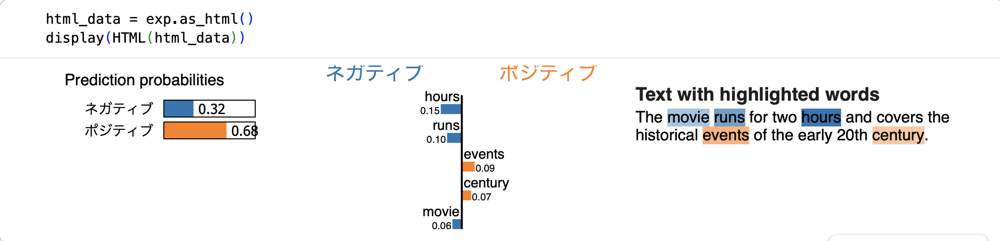

# 013-movie-review-classification-with-LIME

映画レビューのポジションネガティヴ分類と、LIMEによる単語の影響度の確認。

## Overview

IMDBの映画レビューを用いて、ポジティブ・ネガティブの2クラス分類を行った。

SentenceTransformerで文章をベクトル化し、LightGBMで分類するモデルを構築した。  
その後、LIMEを用いて、個別の文章に対する予測と単語ごとの影響度を確認した。

## Dataset

Hugging Faceの `stanfordnlp/imdb` データセットを使用。

* 入力: 映画レビューのテキスト
* 目的変数: `label`
* クラス: ネガティブ / ポジティブ

## Method

### 1. Text Embedding

`sentence-transformers/paraphrase-multilingual-MiniLM-L12-v2` を用いて、レビュー文章をベクトル化した。

### 2. Classification

文章のベクトルを入力として、LightGBMによる2クラス分類を行った。

`classification_report` で分類性能を確認し、一定の分類性能が得られることを確認した。

### 3. LIMEによる解釈

LIMEを用いて、個別の文章に対する予測確率と、予測に影響した単語を確認した。

LIMEでは文章中の単語を取り除くなどして予測の変化を調べ、個別の予測に対する局所的な説明を生成する。

## Results

### Classification

分類性能として、`Accuracy`は`0.7668`であり、
その他の評価指標も下記に示す。

| Class / Metric | Precision | Recall | F1-Score |   
| :--- | :---: | :---: | :---: |   
| **0** | 0.7691 | 0.7625 | 0.7658 |  
| **1** | 0.7645 | 0.7710 | 0.7678 |   

### LIMEによる単語の影響度

LIMEを用いて3件の文章を対象に動作を確認した。

それらのうち、ここでは１つの文章を例としてあげる。

> The movie runs for two hours and covers the historical events of the early 20th century.

映画の長さや歴史的な内容について説明する、特にポジティブ・ネガティブな表現を意図していない文章だが、モデルはポジティブと予測した。

また、LIMEの説明では `hours` や `runs` がネガティブ側、`events` や `century` がポジティブ側に寄与する結果となった。  
下記にスクリーンショットを添付する。

この結果から、**モデルの予測と、単語単位で見た影響度が、必ずしも人間の直感と一致するわけではない**ことが分かった。

## Findings

今回の実験では、文章の分類性能を確認するだけでなく、LIMEを用いて個別の予測を解釈する方法を試した。

今回のモデルは、SentenceTransformerで文章全体をベクトル化し、そのベクトルをLightGBMに入力している。一方、LIMEは文章中の単語を取り除くなどして予測の変化を調べ、単語単位の説明を生成する。

このように、モデルが分類に用いる文章全体のベクトル表現と、LIMEが生成する単語単位の説明には違いがある。そのため、LIMEで示される単語の影響度は、モデルがその単語を常にポジティブ・ネガティブと評価していることを意味するわけではない。

今回の例では、直感的には中立的な文章がポジティブと判定されたり、単語ごとの寄与が直感と異なったりした。LIMEによる説明を通じて、予測結果だけでは分からないモデルの振る舞いを確認できた。

なお、LIMEの動作確認は3件のみであり、今回の結果から一般的な傾向を結論づけることはできない。

## Conclusion

SentenceTransformerとLightGBMを組み合わせた映画レビュー分類を行い、LIMEによる局所的なモデル解釈を試した。
今回の検証を通じて、分類性能の評価に加え、個別の予測に対してモデルがどのような説明を示すかを確認することの重要性を学んだ。

## Tech Stacks
* Python
* collections (Standard Library)
* Hugging Face Datasets
* LightGBM
* LIME
* matplotlib
* pandas
* Polars
* scikit-learn
* seaborn
* SentenceTransformers

