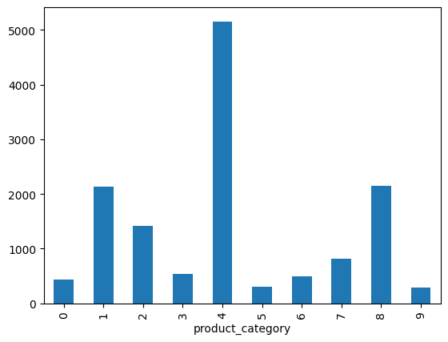
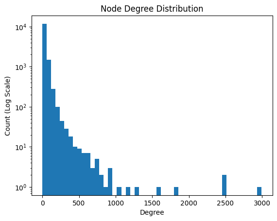
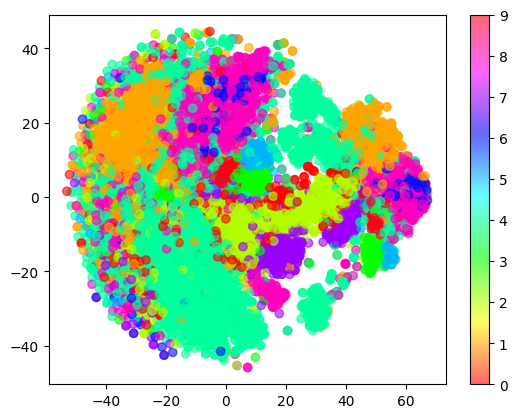
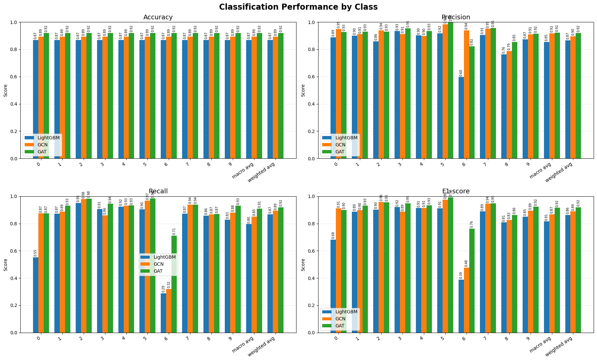

# 014-amazon-computers-node-classification-with-GNN

Amazon Computersデータセットを用いたノード分類と、LightGBM・GCN・GATの性能比較。

## Overview

Amazon上の商品（ノード）の同時購入関係（エッジ）と商品レビューのBag-of-Words特徴量で構成される[Amazonの商品データ](https://pytorch-geometric.readthedocs.io/en/2.5.3/generated/torch_geometric.datasets.Amazon.html)をグラフとして扱い、商品カテゴリのノード分類を行った。

ノードの特徴量のみを使用するLightGBMと、ノードの特徴量に加えてグラフ構造も利用するGCN・GATを比較し、グラフ構造を活用することによる分類性能の違いを確認した。

## Dataset

PyTorch Geometricの `Amazon` データセットから、`Computers` を使用した。

- ノード: 商品
- エッジ: 商品間の関連関係
- ノード特徴量: 商品の特徴を表すバイナリ特徴量
- 目的変数: 商品カテゴリ
- クラス数: 10

## EDA

モデル構築の前に、データの分布とグラフ構造を確認した。

### 1. クラス分布

目的変数の商品カテゴリごとの件数を可視化し、クラス間のデータ数の違いを確認した。

### 2. ノードの次数分布

各ノードが持つエッジ数（次数）の分布を確認した。

### 3. t-SNEによる次元削減

ノードの特徴量をt-SNEで2次元に圧縮し、クラスごとに可視化した。

可視化した範囲ではクラス同士が混在しており、ノード特徴量だけで明確に分類できるとは限らないことが示唆された。

また、エッジ同士で接続されたノードのクラスが一致する割合（エッジ同質性）は約0.777だった。同じクラスのノード同士がつながる傾向が見られ、グラフ構造を利用するGNNが有効である可能性を考えた。

※ t-SNEは高次元データを2次元に圧縮した可視化手法であり、図だけで分類性能を断定することはできない。

## Method

データを学習・検証・テストに **6:2:2** で分割した。分割時には、目的変数のクラス比率が保たれるように層化抽出を行った。

### 1. LightGBM

ノードの特徴量を入力として、LightGBMによる多クラス分類を行った。

グラフ構造は入力に使用せず、GNNとの比較用ベースラインとした。

### 2. GCN

Graph Convolutional Network（GCN）を使用した。

2層のGCNConvを用い、隣接ノードの特徴量を集約しながらノード分類を行った。

### 3. GAT

Graph Attention Network（GAT）を使用した。

2層のGATConvを用い、中間層では8ヘッドのマルチヘッドアテンションを適用した。隣接ノードからの情報をアテンション機構で集約し、ノード分類を行った。

### 学習・評価条件

- 乱数シード: 42
- 損失関数: Cross Entropy Loss
- 最適化手法: Adam
- 学習率: 0.01
- Weight Decay: 0.0005
- Dropout率: 0.5（GCN・GAT）
- 最大エポック数: 500
- Early Stopping: 検証データの損失を用い、50エポック改善しない場合に停止

GNNでは学習時に学習対象ノードの損失だけを計算し、検証データの損失でEarly Stoppingを行った。最終評価はテスト対象ノードに対して実施した。

## Results

評価指標にはAccuracy、Macro F1、Weighted F1を使用した。  

結果のグラフを下記に示す。  

不均衡データであることを考慮した指標を下記にピックアップする。  
| Model | Accuracy | Macro F1 | Weighted F1 |
| :--- | ---: | ---: | ---: |
| LightGBM | 0.8680 | 0.8148 | 0.8629 |
| GCN | 0.8931 | 0.8685 | 0.8886 |
| GAT | **0.9197** | **0.9154** | **0.9193** |

また、モデル差の大きかったクラス６の指標も下記に示す。

| Model | クラス6の Recall | クラス6のF1 |
| :--- | ---: | ---: |
| LightGBM | 0.2887 | 0.3889|
| GCN | 0.3196 | 0.4769 |
| GAT | 0.7113 | 0.7624 |

### Findings

今回の実験では、**GATが最も高い分類性能を示した。**

LightGBMのAccuracyは0.8680だったのに対し、GCNでは0.8931、GATでは0.9197となった。Macro F1でもGATが最も高く、今回の分割条件では、GNNを利用したモデルがLightGBMを上回る結果となった。

また、クラスごとのF1-scoreを見ると、LightGBMではクラス6のF1-scoreが0.3889だったのに対し、GCNでは0.4769、GATでは0.7624となった。特にこのクラスでは、GNNモデルでより高い分類性能が得られた。

さらに、GATでは、クラス6の Recall が約 0.29 → 0.71 に改善している。
全体の Macro F1 が改善しただけでなく、LightGBMが苦手だったクラスの識別も大きく改善していることがわかる。 

今回のデータでは、ノードの特徴量だけでなく、商品間の関連関係を利用することが分類性能の向上につながる可能性が示された。

ただし、今回の比較は単一のデータ分割と設定による実験であり、性能差がグラフ構造や各モデルのどの要素によって生じたかを厳密に切り分けたものではない。また、GNNはグラフ構造を利用するため、LightGBMとは利用できる情報が異なる点にも注意が必要である。

## Conclusion

Amazon Computersデータセットを用いてノード分類を行い、LightGBM・GCN・GATを比較した。

今回の実験ではGATが最も高い性能を示し、ノード特徴量だけでなく、グラフ構造を活用するアプローチの有効性を確認できた。

今後は、モデルのハイパーパラメータ調整や複数の乱数シードによる比較などを通じて、結果の安定性を確認することも考えられる。

## Tech Stacks

- Python
- PyTorch
- PyTorch Geometric
- LightGBM
- scikit-learn
- pandas
- NumPy
- NetworkX
- matplotlib