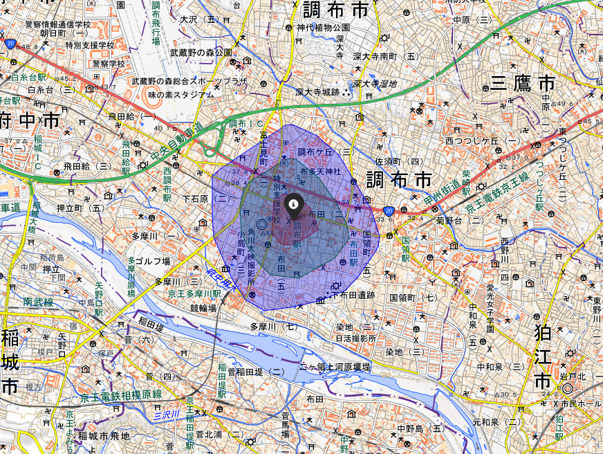

# 015-walking-isochrone-analysis

OSMnxとNetworkXを用いた徒歩の到達圏分析の試行。

## Overview

指定した地点から徒歩で一定時間内に到達できる範囲を、道路ネットワークを利用して可視化した。

OSMnxで道路ネットワークを取得し、NetworkXで出発地点からの到達可能な範囲を計算。その結果をFoliumで地図上に表示した。

## Data Source

Map data © OpenStreetMap contributors (ODbL)

## Target

今回は、東京都調布市の調布駅周辺を対象とした。

- 出発地点: 調布駅
- 緯度: 35.651809
- 経度: 139.544677
- 対象範囲: 出発地点から半径2,000m以内の道路ネットワーク
- 移動手段: 徒歩

調布駅を選んだ理由は、駅徒歩〇〇分などの利用ケースを想定して、ベッドタウンの一つである調布市の駅をサンプルとするためである。

## Method

### 1. 道路ネットワークの取得

OSMnxを使用して、調布駅周辺の徒歩用道路ネットワークを取得した。

OSMnxでは、道路ネットワークをグラフ構造として扱う。

- **Node（ノード）**: 交差点や道路の終端など
- **Edge（エッジ）**: ノード同士をつなぐ道路区間

道路区間には距離などの属性があり、これらを利用して道路に沿った移動距離を計算できる。

### 2. 到達可能な範囲の計算

出発地点に最も近い道路ネットワーク上のノードを取得し、そこから一定距離以内に到達できるノードをNetworkXで抽出した。

今回は徒歩速度を不動産などでも用いられる80m/minとして、以下の3つの時間を対象とした。

| 徒歩時間 | 距離の目安 |
| :--- | ---: |
| 5分 | 400m |
| 10分 | 800m |
| 15分 | 1,200m |

道路ネットワーク上の距離を基準に到達可能なノードを抽出しているため、単純な直線距離による円形の範囲とは異なる。

### 3. 地図への可視化

抽出したノード群から凸包（Convex Hull）を作成し、到達圏の概形をポリゴンとして可視化した。

Foliumを使用して地図上に表示し、徒歩5分圏・10分圏・15分圏を色分けした。

## Results

調布駅を出発地点とした徒歩5分・10分・15分の到達圏を可視化した。

  
Map data © OpenStreetMap contributors (ODbL)

インタラクティブな地図のhtmlデータは、[こちら](interactive_map.html)。

## Findings

地図を確認すると、道路が比較的まっすぐ続いている方向では遠くまで範囲が広がり、道路を何度か曲がる必要がありそうな方向では範囲が短くなる様子が見られた。

道路ネットワーク上の距離を利用することで、直線距離だけでは分からない道路のつながりを考慮した到達範囲を計算できることを確認した。

なお、今回の可視化では、到達可能なノード群から凸包を作成している。そのため、色付きのポリゴンは到達可能な道路の形状そのものではなく、到達範囲の概形を表している。実際には道路ネットワークに沿って到達できない場所もポリゴン内に含まれる可能性がある。

## Conclusion

OSMnx・NetworkX・Foliumを使用して、徒歩の到達圏分析を試した。

道路ネットワークをグラフとして扱い、出発地点からの移動距離に応じて到達可能な範囲を計算・可視化する一連の流れを確認できた。

## Tech Stacks

- Python
- OSMnx
- NetworkX
- Folium
- GeoPandas
- Shapely